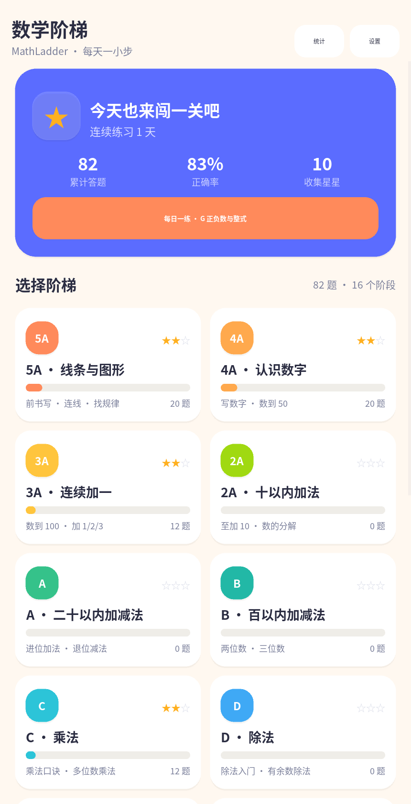
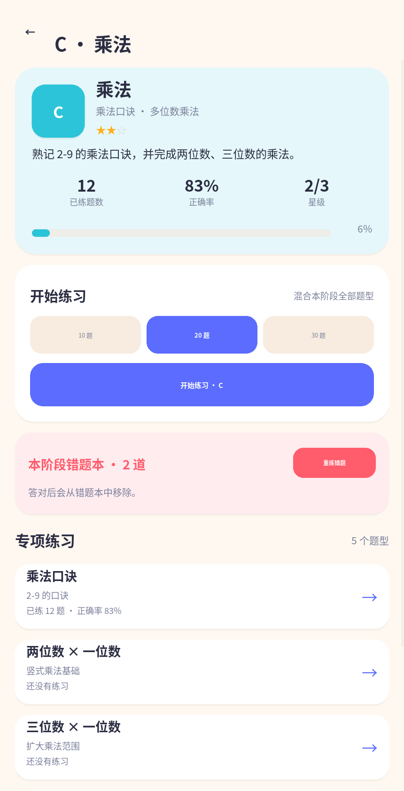
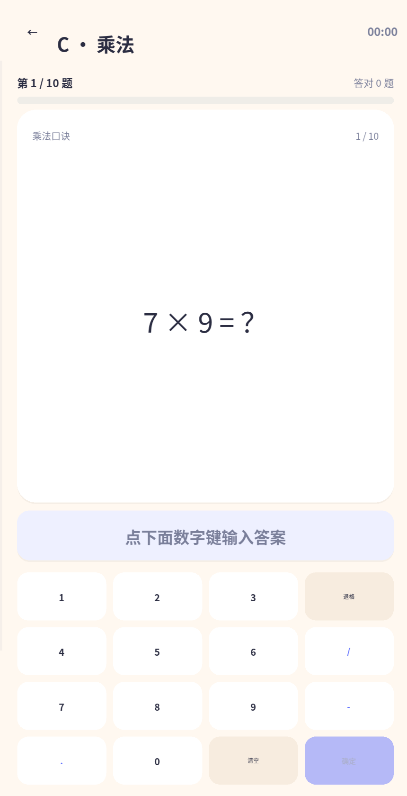
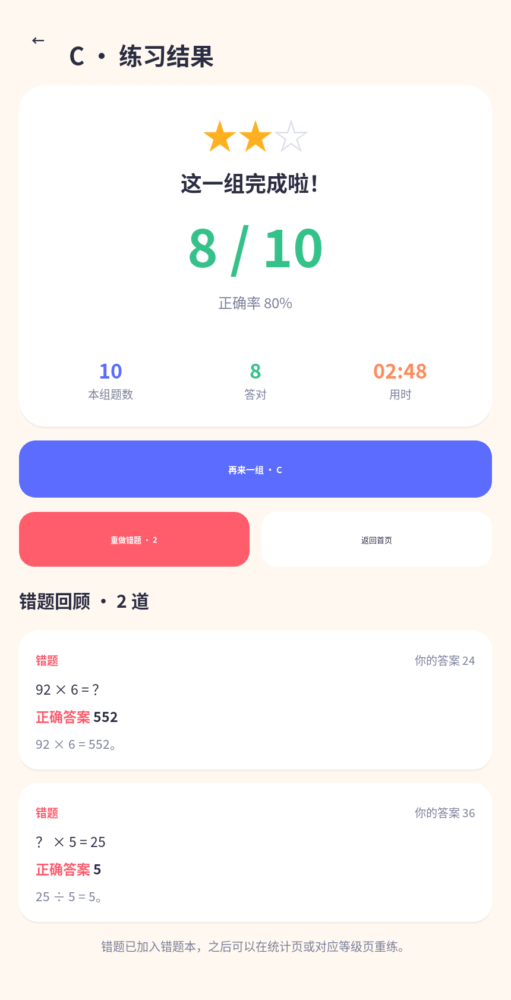
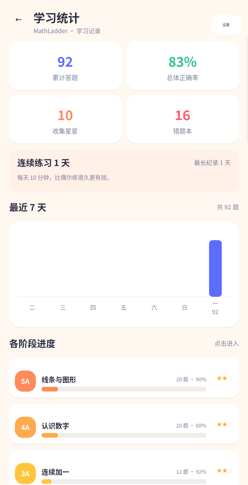
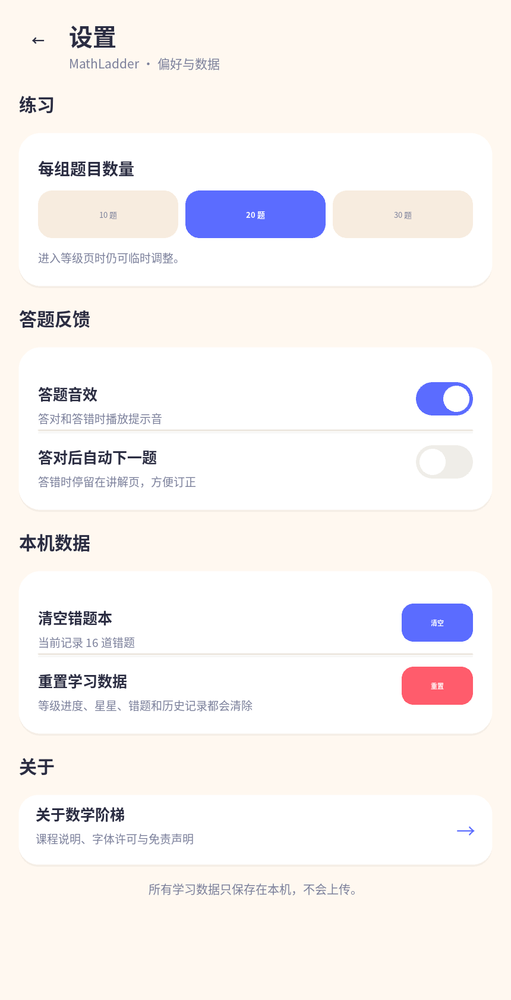
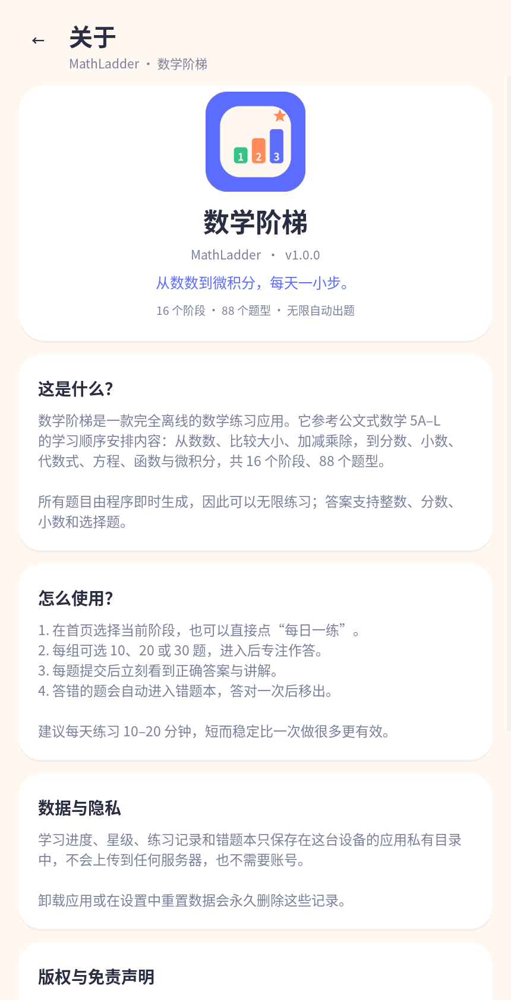

# 数学阶梯 · MathLadder

一款**完全离线**的数学练习 App：参考 5A–L 的阶梯式学习顺序，覆盖从数数、加减乘除到分数、方程、二次函数与微积分的 16 个阶段、88 个题型。题目由 Python 代码即时生成，可以无限练习，不需要账号、没有广告、不上传任何数据。

界面使用纯 Kivy + Python 编写，同一套代码可以运行在 macOS / Windows / Linux 桌面，并通过 Buildozer 打包为 Android APK / AAB。

> 这是一个独立的学习工具，与公文式（Kumon）及其关联公司**没有任何隶属、授权或合作关系**。仓库不包含任何扫描页或教材原题，详见 [NOTICE.md](NOTICE.md)。

## 界面

| 首页 | 阶段 | 做题 | 即时讲解 |
| --- | --- | --- | --- |
|  |  |  |  |
| **结果** | **统计** | **设置** | **关于** |
|  |  |  |  |

截图由 `python tools/make_screenshots.py` 在真实 App 中自动生成。

## 功能

- **16 个阶段 · 88 个题型**：从连线、数感到加减乘除、分数小数、代数式、方程、函数、根式、对数与微积分。
- **无限自动出题**：每个题型都有独立的生成器与错误答案设计，答案可校验、讲解可读。
- **两种作答方式**：选择题与自带数字键盘（支持负号、小数点、分数线），不依赖系统输入法。
- **即时反馈**：答对/答错提示音、正确答案、逐步讲解，可选“答对后自动下一题”。
- **错题本**：自动收集错题，可在统计页或对应阶段重练；答对后自动移出。
- **进度与激励**：星级、连续练习天数、最近 7 天柱状图、各阶段正确率与完成度。
- **纯本地存储**：进度写在应用私有目录的单个 JSON 文件中，原子写入；无网络权限。
- **手机优先布局**：自绘圆角卡片、进度条、图表、开关和对话框，中文字体随包内置。

## 课程范围

| 阶段 | 名称 | 内容 |
| --- | --- | --- |
| `5A` | 线条与图形 | 连线、图形规律、数一数、数字顺序、比多少 |
| `4A` | 认识数字 | 认读数字、数到 50、比较大小、数字拼图 |
| `3A` | 连续加一 | 数到 100、加 1/2/3、数列规律、数的组成 |
| `2A` | 十以内加法 | 10 以内加法、填空、数的分解、三数相加 |
| `A` | 二十以内加减法 | 进位加法、退位减法、加减混合、应用题 |
| `B` | 百以内加减法 | 两位数/三位数加减法、加减填空 |
| `C` | 乘法 | 乘法口诀、两位数/三位数乘法 |
| `D` | 除法 | 表内除法、有余数除法、多位数除法 |
| `E` | 分数加减法 | 同分母分数、约分、分数比较 |
| `F` | 四则运算 | 分数、小数、混合运算、求未知数 |
| `G` | 正负数与整式 | 有理数、整式化简、一元一次方程 |
| `H` | 方程与函数 | 方程组、不等式、一次函数、勾股定理 |
| `I` | 因式分解 | 二次根式、一元二次方程、因式分解 |
| `J` | 根与系数 | 多项式、判别式、韦达定理、分式方程 |
| `K` | 二次函数 | 配方法、最值、指数函数、反比例函数 |
| `L` | 对数与微积分 | 对数、指数方程、导数、积分入门 |

完整题型列表见 [docs/CURRICULUM.md](docs/CURRICULUM.md)。

## 本地运行

需要 Python 3.11 或 3.12（桌面端也已在 3.14 上验证）。Kivy 自带窗口依赖，macOS / Windows 的 pip wheel 可直接使用；Linux 若缺少 SDL2 请先安装系统包。

```bash
python3 -m venv .venv
source .venv/bin/activate

pip install -r requirements-dev.txt

# 手机比例窗口运行
python main.py

# 测试与静态检查
pytest
ruff check app main.py tests tools
```

也可以使用 Makefile：

```bash
make install
make run
make test
make lint
```

运行后进度写入 Kivy 的 `user_data_dir`：

- macOS：`~/Library/Application Support/MathLadder/progress.json`
- Linux：`~/.local/share/MathLadder/progress.json`
- Windows：`%APPDATA%\MathLadder\progress.json`
- Android：应用私有目录（卸载即删除）

## 打包 Android

完整步骤（签名、AAB、上架检查清单）见 [docs/RELEASE.md](docs/RELEASE.md)。

### 用 GitHub Actions 构建（推荐）

1. 把仓库推到 GitHub。
2. 打开 **Actions → Android CI → Run workflow**（或直接 push 到 `main`）。
3. 构建完成后在该次运行页底部下载 `mathladder-debug-apk` 工件。
4. 手机上允许“安装未知来源应用”，安装 APK 即可。

推送 `v*` 标签时，工作流还会自动创建 GitHub Release 并附加 APK：

```bash
git tag v1.0.0
git push origin v1.0.0
```

### 本地构建

Buildozer 的 Android 工具链主要支持 **Linux 和 WSL2**。macOS 上建议直接使用上面的 GitHub Actions。

```bash
sudo apt install -y git zip unzip openjdk-17-jdk \
  autoconf automake libtool pkg-config zlib1g-dev \
  libncurses5-dev libncursesw5-dev libtinfo5 cmake libffi-dev libssl-dev

python3 -m pip install buildozer "cython==0.29.36"
buildozer -v android debug     # 输出 bin/*.apk
buildozer -v android release   # 输出 bin/*.aab（需签名）
```

首次构建会下载 Android SDK/NDK，耗时较长。构建缓存位于 `~/.buildozer` 和 `.buildozer/`。

发布到 Google Play 前请修改 `buildozer.spec` 中的 `package.domain`（应用 ID 一旦上传不可更改）、递增 `version` 与 `android.version_code`，并配置签名密钥。

## 项目结构

```text
.
├── main.py                     # 桌面 / Android 入口
├── app/
│   ├── app.py                  # App、导航、声音、会话生命周期
│   ├── theme.py                # 颜色、字体、尺寸
│   ├── engine/
│   │   ├── curriculum.py       # 16 个阶段与 88 个题型
│   │   ├── generator.py        # 题目生成器与讲解
│   │   ├── checker.py          # 分数/小数/带分数答案校验
│   │   ├── models.py           # Question / SessionResult
│   │   └── session.py          # 组卷与错题重建
│   ├── storage/
│   │   └── repository.py       # JSON 持久化、统计、错题本
│   ├── ui/
│   │   ├── screens/            # 首页、阶段、做题、结果、统计、设置、关于
│   │   └── widgets/common.py   # 自绘卡片、按钮、图表、开关等
│   └── assets/                 # 内置中文字体、图标、音效
├── tests/                      # 131 个引擎 / 存储测试
├── tools/
│   ├── make_screenshots.py     # 自动生成文档截图
│   ├── extract_pdf.py          # 仅本地使用的 PDF 页面提取工具
│   └── make_assets.py          # 生成图标与音效
├── docs/                       # 截图、课程地图、发布指南
├── buildozer.spec              # Android 打包配置
└── .github/workflows/          # Android CI / 签名发布
```

## 测试

```bash
pytest
```

测试覆盖课程表完整性、每个题型的生成质量（ID、选项唯一性、数值答案、markup 合法性）、答案规范化、组卷稳定性、JSON 持久化、星级/连续天数/错题本上限和损坏文件降级等。

## 数据与隐私

- 无网络请求、无统计 SDK、无账号体系。
- Android 清单中不申请任何运行时权限。
- 学习数据只写入应用私有目录，卸载即删除。
- 设置中提供“清空错题本”和“重置学习数据”。

## 版权与免责声明

- 代码以 [MIT License](LICENSE) 发布。
- 内置 Noto Sans SC 字体按 [SIL OFL 1.1](app/assets/fonts/OFL.txt) 使用。
- 本项目不包含、再分发任何教材扫描页或原题；题目全部由代码生成。
- “Kumon / 公文式”是其权利人的商标。本项目为独立作品，与权利人无隶属、授权或合作关系，也不得使用其名称、标志或教材图片进行宣传。
- 本项目不构成教育、考试或医疗建议；请根据学习者情况合理使用。

详见 [NOTICE.md](NOTICE.md)。
